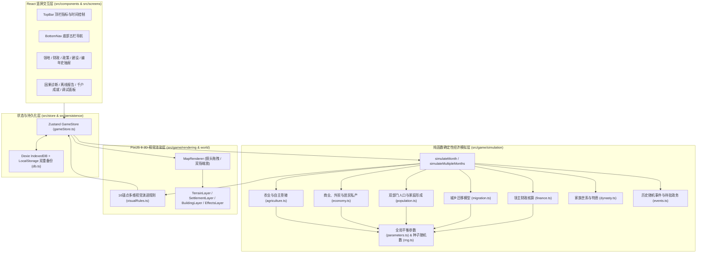

# Medieval Lordship（中世纪领地治理）— MVP 研发与架构详尽报告

## 1. 项目概述与核心设计原则落地

**Medieval Lordship** 是一款以 9—11 世纪英格兰河谷庄园为历史原型的手机竖屏休闲领地治理模拟游戏。本次交付完成了从零构建、可完整游玩、支持本地持久化与离线时间演算、并具备自动化平衡测试验证的最小可行产品（MVP）。

在架构与数值实现中，本项目严格贯彻了任务书提出的八大核心产品设计原则：

| 设计原则 | 工程与机制实现方式 |
|---|---|
| **1. Passive by default（默认自主演进）** | 无论玩家是否操作，农业耕作、荒地开垦、家庭积蓄、青年分家建房、手工作坊涌现、人口出生与迁徙、家族代际更替均按月/年自动推进。 |
| **2. Meaningful decisions（有意义的决策）** | 地租、土地、贸易政策与治安/维护预算均存在真实权衡（例如高地租短期充盈金库，但抽干佃农私产从而抑制自主开垦与新户裂变）。 |
| **3. Visible growth（可视化的领地生长）** | 地图绝非静态背景或几张硬切换图片，而是基于 PixiJS 8 分层渲染与 16 个发展锚点的连续生长系统（农田条块增加、森林后退、村落房屋加密、桥梁磨坊集市城墙逐步落成）。 |
| **4. No micromanagement（零微操负担）** | 玩家无需手动摆放农舍、铺设道路或分配单个工人；投资公共工程后由系统在预设河湾、渡口、高地锚点自动选址施工。 |
| **5. No urgency（无逼氪/逼肝倒计时）** | 离线期间管事按既定法令运转领地，随机事件设有安全边界，商人集市宪章与行会请愿进入无时限待办列表，等待领主上线后从容批阅。 |
| **6. Explainable economy（可解释的经济因果）** | 人口与商业增长绝不使用固定常数，而是由粮食结余、土地承载力、私产积蓄、交通便利度共同决定，并通过内置的“发展解释引擎”向玩家透明展示近 10 年因果诊断。 |
| **7. Simple interface, deep simulation（简明界面，深层模拟）** | 针对 375–430px 手机竖屏设计单手操作界面（顶栏核心指标 + 中部可拖拽缩放全景地图 + 底部五栏抽屉），将复杂双部门经济模型封装于后台。 |
| **8. Expandable architecture（可扩展架构）** | 模拟引擎纯函数化、配置参数集中管理、存档带版本号与自动迁移校验、美术素材配置清单化。 |

---

## 2. 系统架构与代码目录结构

游戏采用 **“确定性模拟内核 + Zustand 状态桥接 + PixiJS 8 场景渲染 + React UI 抽屉 + Dexie/IndexedDB 持久化”** 的分层解耦架构。经济模拟完全独立于 React 组件生命周期与 PixiJS 渲染帧率。

### 核心模块文件清单

- **状态与世界模型 (`src/game/world/`)**
  - [worldState.ts](file:///Users/youhanfang/development/game-lord/src/game/world/worldState.ts)：定义 [`GameState`](file:///Users/youhanfang/development/game-lord/src/game/world/worldState.ts#L196-L212) 及其全部子状态接口（人口、农业、经济、财政、政策、建筑、片区、家族、事件、地图锚点）。
  - [progression.ts](file:///Users/youhanfang/development/game-lord/src/game/world/progression.ts)：实现 [`createInitialGameState`](file:///Users/youhanfang/development/game-lord/src/game/world/progression.ts#L8-L157)（公元 900 年初始庄园）与本地规则驱动的可解释经济诊断生成器 [`generateDevelopmentExplanation`](file:///Users/youhanfang/development/game-lord/src/game/world/progression.ts#L168-L325)。
  - [visualRules.ts](file:///Users/youhanfang/development/game-lord/src/game/world/visualRules.ts)：实现 [`updateWorldVisualState`](file:///Users/youhanfang/development/game-lord/src/game/world/visualRules.ts#L13-L217)，综合人口、商业、基建、土地控制与治安计算聚落阶段与 16 个锚点等级。
- **确定性模拟引擎 (`src/game/simulation/`)**
  - [parameters.ts](file:///Users/youhanfang/development/game-lord/src/game/simulation/parameters.ts)：集中管理所有经济、农业、人口、迁移、财政与贸易系数（[`SIMULATION_PARAMETERS`](file:///Users/youhanfang/development/game-lord/src/game/simulation/parameters.ts#L5-L185)）。
  - [rng.ts](file:///Users/youhanfang/development/game-lord/src/game/simulation/rng.ts)：实现可序列化的确定性伪随机数生成器 [`SeededRandom`](file:///Users/youhanfang/development/game-lord/src/game/simulation/rng.ts#L5-L58)。
  - [agriculture.ts](file:///Users/youhanfang/development/game-lord/src/game/simulation/agriculture.ts)：实现农业生产、天气抽样、农具升级与农民自主开垦逻辑（[`calculateAnnualAgriculture`](file:///Users/youhanfang/development/game-lord/src/game/simulation/agriculture.ts#L39-L227)）。
  - [economy.ts](file:///Users/youhanfang/development/game-lord/src/game/simulation/economy.ts)：实现治安、对外交通便利度、粮食进出口、商业繁荣度、手工作坊自主开设及居民私人财富核算（[`calculateAnnualEconomyAndPrivateWealth`](file:///Users/youhanfang/development/game-lord/src/game/simulation/economy.ts#L24-L246)）。
  - [migration.ts](file:///Users/youhanfang/development/game-lord/src/game/simulation/migration.ts)：实现农业佃农与非农工匠/商人的迁入与迁出模型（[`calculateAnnualMigration`](file:///Users/youhanfang/development/game-lord/src/game/simulation/migration.ts#L19-L176)）。
  - [population.ts](file:///Users/youhanfang/development/game-lord/src/game/simulation/population.ts)：实现自然出生、死亡、城乡人口流动及青年人口耗资建房分户逻辑（[`calculateAnnualPopulation`](file:///Users/youhanfang/development/game-lord/src/game/simulation/population.ts#L28-L254)）。
  - [finance.ts](file:///Users/youhanfang/development/game-lord/src/game/simulation/finance.ts)：实现领主六大收入源与四大支出项核算（[`calculateAnnualFinance`](file:///Users/youhanfang/development/game-lord/src/game/simulation/finance.ts#L10-L157)）。
  - [dynasty.ts](file:///Users/youhanfang/development/game-lord/src/game/simulation/dynasty.ts)：实现领主与继承人年龄增长、自然离世、世代交替与家主特质传承（[`advanceAnnualDynasty`](file:///Users/youhanfang/development/game-lord/src/game/simulation/dynasty.ts#L15-L103)）。
  - [events.ts](file:///Users/youhanfang/development/game-lord/src/game/simulation/events.ts)：实现丰歉、严冬、商队、盗匪、春瘟、自由农来投及特许状请愿事件（[`evaluateAnnualRandomEvents`](file:///Users/youhanfang/development/game-lord/src/game/simulation/events.ts#L18-L234)）。
  - [simulation.ts](file:///Users/youhanfang/development/game-lord/src/game/simulation/simulation.ts)：核心月度步进函数 [`simulateMonth`](file:///Users/youhanfang/development/game-lord/src/game/simulation/simulation.ts#L26-L343) 与批量离线/快进演算函数 [`simulateMultipleMonths`](file:///Users/youhanfang/development/game-lord/src/game/simulation/simulation.ts#L349-L418)。
- **数据字典 (`src/data/`)**
  - [buildings.ts](file:///Users/youhanfang/development/game-lord/src/data/buildings.ts)：定义 12 项公共设施投资（[`BUILDING_DEFINITIONS`](file:///Users/youhanfang/development/game-lord/src/data/buildings.ts#L20-L249)）与 5 个河谷扩张片区（[`INITIAL_REGION_EXPANSIONS`](file:///Users/youhanfang/development/game-lord/src/data/buildings.ts#L251-L312)）。
  - [policies.ts](file:///Users/youhanfang/development/game-lord/src/data/policies.ts)：定义地租、土地、贸易政策与预算选项的展示元数据。
  - [mapAnchors.ts](file:///Users/youhanfang/development/game-lord/src/data/mapAnchors.ts)：定义 16 个地图预设锚点坐标与描述（[`INITIAL_MAP_ANCHORS`](file:///Users/youhanfang/development/game-lord/src/data/mapAnchors.ts#L7-L168)）。
  - [events.ts](file:///Users/youhanfang/development/game-lord/src/data/events.ts)：定义 6 种领主特质（[`LORD_TRAITS`](file:///Users/youhanfang/development/game-lord/src/data/events.ts#L3-L34)）与盎格鲁-撒克逊历史人名库。
- **PixiJS 8 地图渲染 (`src/game/rendering/`)**
  - [MapRenderer.ts](file:///Users/youhanfang/development/game-lord/src/game/rendering/MapRenderer.ts)、[TerrainLayer.ts](file:///Users/youhanfang/development/game-lord/src/game/rendering/TerrainLayer.ts)、[SettlementLayer.ts](file:///Users/youhanfang/development/game-lord/src/game/rendering/SettlementLayer.ts)、[BuildingLayer.ts](file:///Users/youhanfang/development/game-lord/src/game/rendering/BuildingLayer.ts)、[EffectsLayer.ts](file:///Users/youhanfang/development/game-lord/src/game/rendering/EffectsLayer.ts)。

---

## 3. 经济与人口模拟系统深度解析

### 3.1 初始基准状态校验（公元 900 年）

在 [`createInitialGameState`](file:///Users/youhanfang/development/game-lord/src/game/world/progression.ts#L8-L157) 中，初始数值严格对应设计规格：
- **家庭与人口**：总计 `10` 户（`50` 人），其中农业家庭 `10` 户、非农业家庭 `0` 户；农户初始私人总积蓄 `14.0` 金币，住宅容量 `13` 栋。
- **土地与农业**：控制土地 `250` 公顷，潜在可耕地 `90` 公顷，已开垦耕地 `45` 公顷，当年实际播种 `30` 公顷（二圃/三圃轮作基准播种率 `66.7%`）。
- **粮食平衡**：单产 `0.8` 吨/公顷 $\rightarrow$ 年总产量 `24.0` 吨；扣除留种 `5.3` 吨（`22.08%`）与收获储运损耗 `1.9` 吨（`7.92%`），净可用产量为 `16.8` 吨；50 人年消费粮食 `12.5` 吨（人均 `0.25` 吨/年），首年正常气候下净盈余 `+4.3` 吨；期初存粮 `8.0` 吨。
- **领主财政**：期初金库 `40.0` 金币；年收入 `9.5` 金币（地租 `6.0` + 自营庄园 `3.5`），年支出 `7.7` 金币（家族生活 `4.0` + 行政 `1.5` + 防卫 `2.0` + 设施维护 `0.2`），年度结余 `+1.8` 金币。

### 3.2 农业生产与农民自主垦殖模型 ([agriculture.ts](file:///Users/youhanfang/development/game-lord/src/game/simulation/agriculture.ts))

1. **有效耕作与播种面积**
   $$\text{有效耕作面积} = \min(\text{已开垦耕地}, \text{农业户数} \times 4.6\text{公顷/户})$$
   $$\text{实际播种面积} = \text{有效耕作面积} \times \text{轮作播种比}$$
   其中轮作播种比初始为 `0.667`，建成【农田改良工程】后随维护效能提升至 `0.78`。
2. **产量、留种与损耗**
   $$\text{总产量} = \text{播种面积} \times 0.8 \times \text{肥力系数} \times \text{天气系数} \times \text{技术系数}$$
   - **天气系数**：每年按概率抽取丰收（`1.20`，概率 22%）、正常（`1.00`，概率 58%）、歉收（`0.78`，概率 14%）、严冬（`0.72`，概率 6%）。
   - **技术与损耗改善**：农户积累足够私产后会自主斥资升级农具（`toolsLevel` 从 `1.00` 渐进升至 `1.32`）；领主建设【水磨坊】与【石基大谷仓】可分别提升技术系数 `+8%`、`+6%`，并将基础损耗率从 `7.92%` 最低降至 `3.72%`。
3. **农民自主开垦荒地（无需玩家手点）**
   当满足以下 4 个条件时，农民每年自动将潜在可耕地转化为已开垦耕地：
   - 存在未开垦的潜在耕地（`arablePotentialHa > cultivatedLandHa`）；
   - 领地治安达标（`security >= 42`）；
   - 农户拥有私人积蓄（每开垦 1 公顷需消耗农户私产 `0.75` 金币，且每年最多动用私产的 30% 用于垦荒）；
   - 开垦速度受【土地政策】（鼓励开垦 `×1.55` / 维持现状 `×1.0` / 保护林地 `×0.38`）、【地租政策】（低地租 `×1.25` / 高地租 `×0.68`）及领主【垦殖先锋】特质（`×1.20`）共同调制。

### 3.3 居民私产核算与商业贸易系统 ([economy.ts](file:///Users/youhanfang/development/game-lord/src/game/simulation/economy.ts))

- **居民财富与领主金库严格分离**：
  - **农业家庭私产变化** = 农业净收成经济价值 + 城镇余粮内销 + 粮食外贸出口分成 + 林牧副业产出 - 家庭基本生活支出 - 领主地租 - 私人投资（自主开垦荒地 + 升级农具 + 修建新农舍）。
  - **非农家庭（工匠/商人）私产变化** = 手工业与商贸总产出 - 家庭生活支出 - 领主工商税 - 外部买粮支出 - 自主兴办手工作坊投资。
- **商业繁荣度与粮食进口机制**：
  - `tradeAccess`（对外交通便利度）由基础值（`12`）叠加【跨河木石桥】（`+16`）、【定期集市广场】（`+22`）、【硬化商道】（`+20`）、【工匠街区】（`+14`）、【集市/行会特许状】及贸易政策计算得出。
  - 当本地人口增长超过本地农田产出时，若已建成桥梁或集市，商队会根据 `foodImportCapacityTons`（受 `tradeAccess` 与 `security` 限制）和居民私产支付能力**自动从外部进口粮食**，从而支撑数百户非农业城镇人口，同时绝不会无成本、无上限地凭空产粮。

### 3.4 双部门人口、迁移与新家庭分户 ([population.ts](file:///Users/youhanfang/development/game-lord/src/game/simulation/population.ts) & [migration.ts](file:///Users/youhanfang/development/game-lord/src/game/simulation/migration.ts))

1. **自然增长（出生与死亡）**：
   - 出生率受粮食充裕度、家庭平均积蓄、领主【仁厚】特质及土地饱和度影响；
   - 死亡率受饥荒程度、严冬、春瘟影響，兴建【教区教堂】与保持高维护预算可显著降低死亡率。
2. **区分“新增人口”与“新增家庭（分户建房）”**：
   - 婴儿出生只增加 `farmPopulation` 或 `nonFarmPopulation`（提高户均人口），**绝不会每出生一人就加一户**。
   - 只有当户均人口超过阈值（`> 5.15` 人/户）、粮食不匮乏、**居民拥有足够的私人积蓄支付建房费用（每新建一栋住宅需消耗私产 `1.35` 金币）**，且领地存在未饱和的耕地或工商业岗位时，青年人口才会独立分家形成新户（`newHouseholdsFormed`）。
   - 当农业土地趋于饱和而集市商业繁荣时，新分家的农村青年会自动向城镇转移，成为非农业手工业家庭。

---

## 4. 地理承载力突破与千户成长路径

初始领地仅控制 `250` 公顷土地（其中潜在可耕地 `90` 公顷）。如果完全不扩张土地、不发展贸易，仅靠初始 90 公顷耕地最多只能供养约 **28—38 户** 农业家庭。

为了让玩家能够真正从 10 户发展到 **1,000 户以上**，系统设计了完整的“五阶段区域整合 + 工商业城镇化”路径（[buildings.ts](file:///Users/youhanfang/development/game-lord/src/data/buildings.ts#L251-L312)）：

| 扩张片区名称 | 新增控制土地 | 新增潜在耕地 | 吸纳原住民 | 所需户数 / 威望 / 赎金 | 对应地图锚点 |
|---|---:|---:|---:|---|---|
| **初始核心庄园** | 250 公顷 | 90 公顷 | 10 户 | 初始拥有 | `main_settlement` / `farmland_a` |
| **1. 河东肥沃草甸与聚落** | +200 公顷 | +110 公顷 | +8 户 | 22 户 / 15 威望 / 45 金 | `east_village` |
| **2. 西丘林间垦区与村落** | +240 公顷 | +125 公顷 | +12 户 | 55 户 / 28 威望 / 85 金 | `west_village` |
| **3. 下游河湾渡口与渔农聚落** | +260 公顷 | +135 公顷 | +16 户 | 120 户 / 45 威望 / 140 金 | `river_hamlet` |
| **4. 北境谷地封邑** | +320 公顷 | +180 公顷 | +25 户 | 260 户 / 70 威望 / 220 金 | `farmland_c` |
| **5. 王室自治市镇郊野特许领** | +380 公顷 | +210 公顷 | +35 户 | 500 户 / 105 威望 / 340 金 | `outer_suburb` |
| **全河谷整合总计** | **1,650 公顷** | **850 公顷** | **共吸纳 106 户** | — | 全河谷 16 锚点贯通 |

当全部片区整合后，`850` 公顷优质三圃轮作耕地可承载约 **600—700 户** 农业家庭，配合【跨河木石桥 + 定期集市 + 硬化王家商道 + 工匠行会街区】支撑的 **350—450 户** 城镇工商业家庭与外部进口粮流，使总户数自然突破 **1,000+ 户**。

---

## 5. 视觉渲染系统与美术资源体系

### 5.1 PixiJS 8 四层渲染管线 ([src/game/rendering/](file:///Users/youhanfang/development/game-lord/src/game/rendering/))

1. **[`TerrainLayer`](file:///Users/youhanfang/development/game-lord/src/game/rendering/TerrainLayer.ts)**：
   - 绘制 `1000 × 1600` 竖屏河谷底图：蜿蜒的艾什河（浅滩、河岸沙洲、深浅水流层）、西北与东南低矮丘陵、柔绿草甸。
   - **动态农田层 (`drawFarmland`)**：根据 `cultivatedLandHa` 实时绘制小麦、大麦与休耕条田；未开垦的潜在耕地显示为带木桩边界的荒草甸；建成【农田改良工程】后田垄升级为蓝色灌溉排水渠。
   - **动态道路层 (`drawRoads`)**：随聚落与桥梁发展自动延伸连接河东、西丘、北境与下游码头，并在建成【硬化商道】后由黄土路升级为石砌干道。
2. **[`SettlementLayer`](file:///Users/youhanfang/development/game-lord/src/game/rendering/SettlementLayer.ts)**：
   - **森林退缩机制 (`drawForests`)**：随耕地开垦比例上升，古橡木林边缘自动后退；若施行【保护林地】政策则保留茂密林苑并生成林官小屋。
   - **聚落演化 (`drawSettlements`)**：10 户时呈现稀疏的带篱笆茅草农舍；随人口与非农比例上升，外围村落（河东村、西丘村、下游码头、南郊街区）逐步解锁，核心区自动演变为双层半木结构市镇排屋与悬挂招牌的手工作坊。
3. **[`BuildingLayer`](file:///Users/youhanfang/development/game-lord/src/game/rendering/BuildingLayer.ts)**：
   - 绘制领主庄园（从 Lv.1 木石长屋演进至 Lv.5 双塔诺曼石堡）、带旋转水轮的水磨坊、跨河拱桥、彩色帐篷集市与十字碑、高耸钟楼教堂、石基谷仓、木栅栏哨塔与环城条石城墙。
   - 施工中的建筑自动显示脚手架与绿色进度条；所有主要锚点均带可点击标签，支持玩家点击查看详情。
4. **[`EffectsLayer`](file:///Users/youhanfang/development/game-lord/src/game/rendering/EffectsLayer.ts)**：
   - 以稳定的 60 FPS 驱动轻量级环境动画：河水涟漪流动、水磨坊水轮旋转、农舍与铁匠铺袅袅炊烟、草甸绵羊觅食、道路上的行人与商队篷车。

### 5.2 美术资源清单与后续替换指南

所有素材元数据均规范定义于 [`ASSET_MANIFEST`](file:///Users/youhanfang/development/game-lord/src/assets/assetManifest.ts#L20-L194)，并在 `public/assets/sprites/` 目录下提供了原创 SVG 矢量资产示例。若后续需替换为 AI 生成的高清 PNG/WebP 贴图，只需将图片置于对应 `assetPath`，并在渲染层通过 `Assets.load(entry.assetPath)` 加载 `Sprite`，直接复用清单中的 `width`、`height`、`anchorPoint`、`scale` 与 `zIndex` 即可。

---

## 6. 经济平衡自动化测试报告

测试套件 [simulation.test.ts](file:///Users/youhanfang/development/game-lord/src/tests/simulation.test.ts) 对任务书第 13 节要求的全部 6 个情景进行了自动化断言验证，执行耗时 `< 400ms`，全部通过：

1. **初始数值与确定性验证**
   - 验证公元 900 年开局各项指标与任务书表格完全一致。
   - 验证相同初始状态 + 相同随机种子 `777888` 推进 50 年（600 个月），两次独立运行的人口、户数、金库、耕地面积与最终随机种子状态 **100% 严格相等**。
2. **情景 A：完全不操作（模拟 100 年）**
   - 保持默认政策完全挂机 100 年（公元 900 $\rightarrow$ 1000 年）：农民利用私产自主将耕地从 `45` 公顷开垦至 `84.6` 公顷（接近 `90` 公顷上限）；总户数从 `10` 户自然增长并稳定在初始土地承载上限附近（约 `31` 户），证明系统能自主运行且受土地承载力约束，不会无脑无限膨胀。
3. **情景 B & C：高地租 vs 低地租+鼓励开垦（对比模拟 15 年）**
   - **低地租 + 鼓励开垦**：农民私产充裕，15 年内开垦耕地更快、家庭私产留存与总户数均显著高于高地租情景。
   - **高地租**：领主短期金库余额更高，但因抽走大量民间积蓄，农民开荒与新家庭建房速度明显受抑，验证了政策取舍的真实因果。
4. **情景 D：公共投资驱动力（水磨坊、桥梁、集市）**
   - 投资兴建水磨坊、桥梁与定期集市后，磨坊收益与市场税费自动体现在财政账本中，商业繁荣度升至 `20+`，非农业家庭从 `0` 户增长至 `10+` 户，地图对应锚点自动点亮升级。
5. **情景 E & F：领地扩张与长期繁荣（1000 户可行路径验证）**
   - 模拟积极治理路径（前期低地租鼓励开垦、中期恢复正常地租积累金库、依次兴建 12 项公共设施、赎买并入 5 个周边片区、批准集市与行会特许状）：在约 **195—225 年** 内，领地控制土地扩展至 `1,650` 公顷，总户数顺利突破 **1,000 户**（其中非农业工商业家庭达 `300+` 户），聚落阶段演进为 `fortified_city`（设防大重镇），触发千户荣耀成就弹窗。

---

## 7. 审阅与测试操作指引

为了方便你全面 Review 各项功能，建议按以下步骤在浏览器（推荐 Chrome 手机模拟器 iPhone 12/14 Pro 竖屏视图 `390×844`）中体验：

1. **观察初始 10 户庄园与动画**：打开 http://localhost:5173/ ，观察蜿蜒艾什河、10 户茅草农舍、炊烟、放牧绵羊、南坡初始条田与西湾待开垦荒地；尝试单指拖拽地图、双指/滚轮缩放、点击地图上的建筑标签查看详情。
2. **体验发展因果解释**：点击顶栏的【10 户】【40 金】【8.0 吨】【商 5】任意胶囊按钮，查看本地规则引擎生成的近 10 年发展诊断与瓶颈建议。
3. **体验政策调整与公共建设**：打开底部【政策】切换为“低地租 + 鼓励开垦”，观察【财政】面板中预计年收入的即时变化；打开【建设】查看 12 项公共工程与 5 大扩张片区的前置条件。
4. **使用开发者调试面板快速验证百岁演进**：
   - 点击顶栏右上角【调试】按钮打开开发者测试面板；
   - 点击【+10 年】【+50 年】【+100 年】，观察人口、耕地、家主代际更替与地图风貌的真实演进；
   - 点击【模拟离开 8 小时】，测试离线结算报告弹窗与编年史跳转；
   - 点击【~60户】【~180户】【~450户】【1000+户】场景按钮，一键检视不同历史阶段下通过真实模拟生成的城镇规模、财政结构与环城石墙/诺曼石堡视觉表现。

